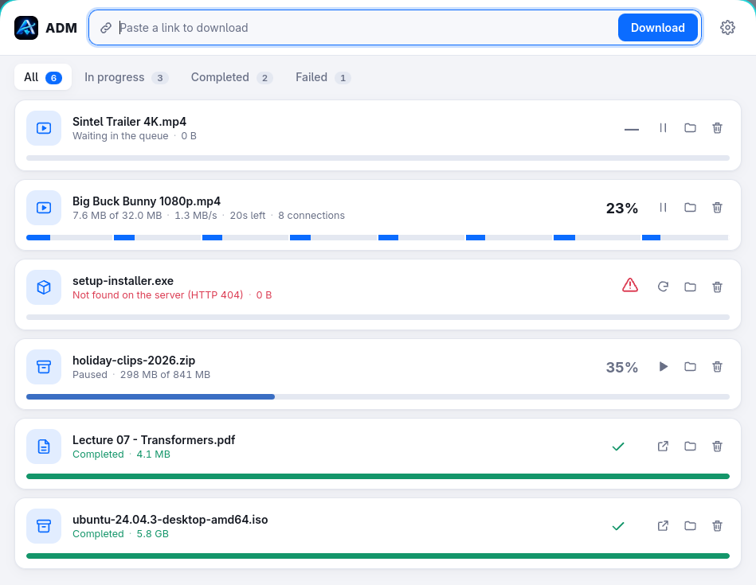
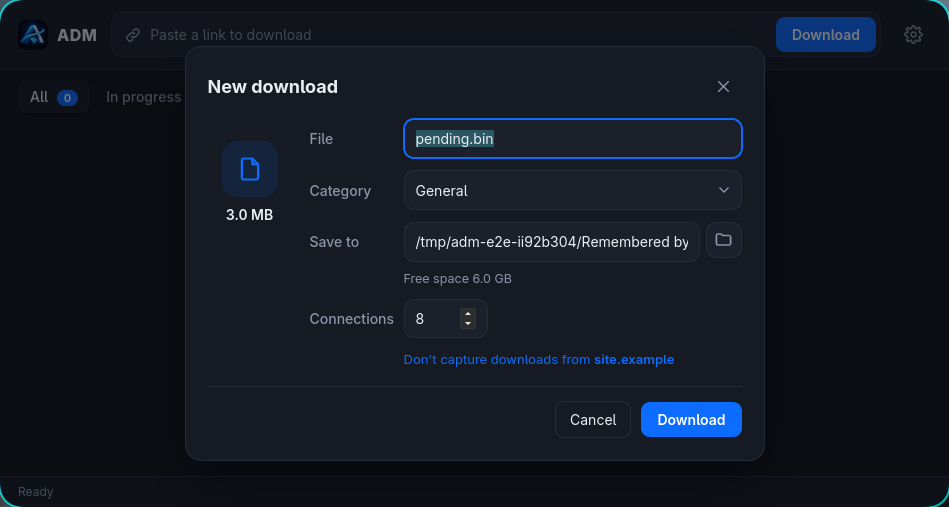
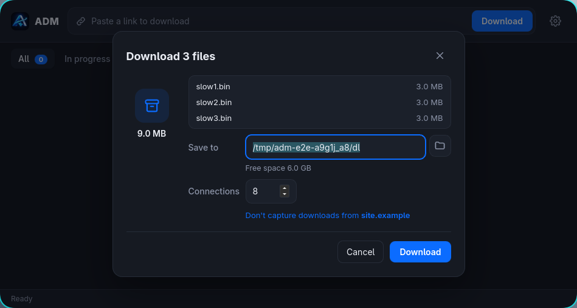
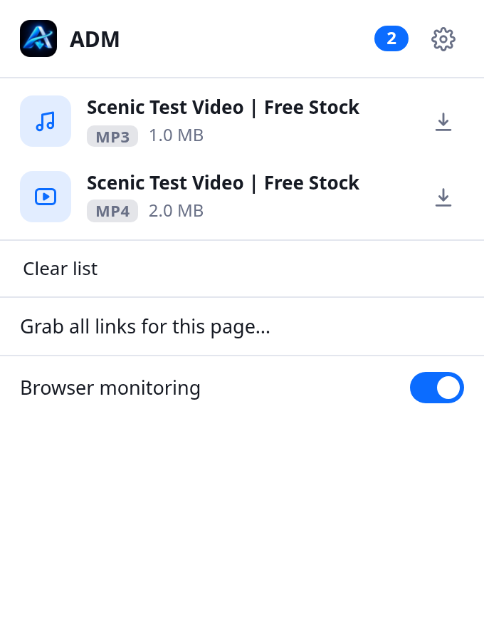
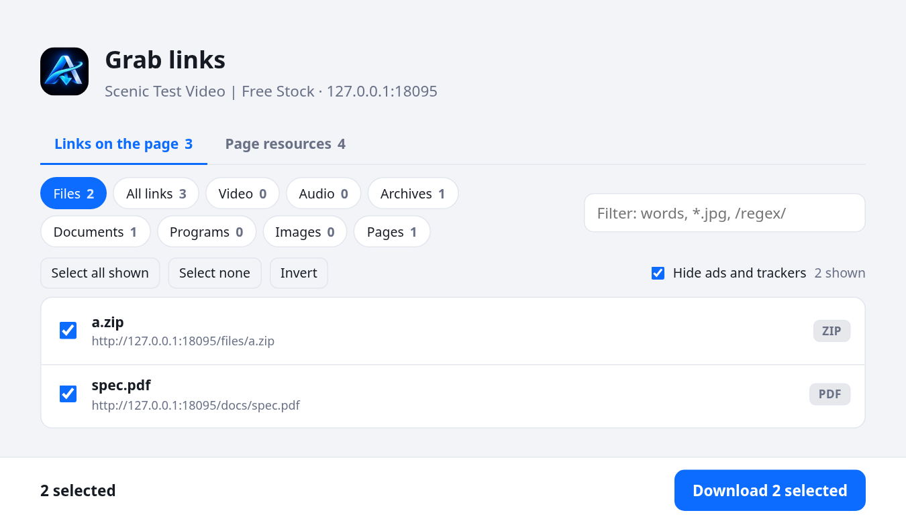

<p align="center">
  
</p>

<h1 align="center">ADM</h1>

<p align="center">
  <b>A fast, lightweight download manager: multi-connection speed, pause and resume, and browser integration, in a ~5&nbsp;MB app.</b>
</p>

<p align="center">
  <a href="https://github.com/Axenith/ADM/releases/latest"></a>
  <a href="LICENSE"></a>
  
  
</p>

<p align="center">
  <picture>
    <source media="(prefers-color-scheme: dark)" srcset="docs/screenshots/main-dark.png">
    
  </picture>
</p>
<p align="center"><sub>Sample data: the finished and paused rows are made up; the failed one is a real download whose link answered 404.</sub></p>

ADM splits each download across several connections, keeps going when your connection drops, and picks up where it stopped. The app is a single native binary of about **5 MB** that uses your system's web view, instead of shipping its own runtime. A small browser extension sends your downloads to it.

It is inspired by [XDM (Xtreme Download Manager)](https://github.com/subhra74/xdm), whose install size grew large because it bundles a Java runtime. ADM aims for the same behaviour at a fraction of the size.

> **Status: early (0.1.0; the repository is ahead of that release).** It is used and tested on **Linux**. Windows and macOS builds are not verified yet. See the [roadmap](#roadmap).

## Features

**Downloading**
- **Multi-connection downloads.** A file is split into ranges that run in parallel. When a connection finishes, the busiest range is split in half, so every connection stays busy to the end.
- **Resume that is safe.** Progress is saved only once it is on disk, so a crash loses at most a little. A changed file on the server is detected and never spliced into the old one.
- **Expired links.** If a signed link starts being refused after part of the file arrived, ADM goes back through the original link for a fresh one.
- **Queue.** Run a few downloads at a time (default 3); the rest wait and start in order.
- **Speed limit**, retries with back-off, unknown-size streams, servers without range support.
- **Never overwrites.** A finished file takes a free name (`name (1).ext`).

**The app**
- **"New download" window** like XDM's: file name, category, save folder (with a Browse button), free space, connections, and *Don't capture from this site*. ADM remembers the folder you chose last.
- **Batches.** Several links arrive in one window instead of one per link.
- Pause, resume, retry, open file, show in file manager, remove, or move the file to the trash.
- **Runs from the tray.** Closing the window frees the web view's memory; downloads keep going.
- **One copy only.** Launching ADM again brings up the running one.
- Dark and light themes. No framework in the UI: plain HTML, CSS and JavaScript (about 40 KB).

**For AI agents**
- `adm-dl mcp` is an MCP server (Claude Code, opencode, Gemini CLI, Codex, Cursor): `adm_download`, `adm_status`, `adm_cancel`, `adm_probe`. Several connections, resume, checksum check, and long downloads that report back with a job id instead of timing out. No GUI needed. See [docs/AGENTS.md](docs/AGENTS.md).
- `adm-dl <url> --json` for any agent with a shell: one JSON line when done, meaningful exit codes.

**Browser extension** (Chrome, Brave and other Chromium browsers)
- Browser downloads open in ADM. If ADM is not running, the browser downloads as usual: a download is never lost.
- **You choose what it takes over.** In ADM's settings, list the file types (and a size above which anything is taken); everything else stays with the browser. Sites you mark *Don't capture* are left alone.
- **Browser monitoring** (opt-in) lists the videos and audio a page loads, with a download button each. Slices of a YouTube-style stream are not listed as videos.
- **Exact replay** (with monitoring on): the download is repeated with the headers and cookies your browser really sent. A download that is not a plain GET (a file made by a form) stays with the browser, because it cannot be repeated from an address.
- **Grab links** (Alt+Shift+G): the links on a page, or everything the page loads (images at their largest size, videos, posters, CSS backgrounds). Filter by type, by words, by pattern (`*.jpg`) or by `/regex/`; hide ads and trackers; invert the selection; send them to ADM as one group.
- Right-click a link: **Download with ADM**. Private windows are never captured.

<p align="center">
  
  
</p>
<p align="center">
  
  &nbsp;
  
</p>

## Install

### Linux, from a release

1. Install **WebKitGTK 4.1**: Arch `pacman -S webkit2gtk-4.1`, Debian/Ubuntu `apt install libwebkit2gtk-4.1-0`, Fedora `dnf install webkit2gtk4.1`.
2. Download `adm-<version>-linux-x86_64.tar.gz` from [Releases](https://github.com/Axenith/ADM/releases/latest), then:
   ```sh
   tar xzf adm-*-linux-x86_64.tar.gz
   cd adm-*-linux-x86_64
   ./install.sh          # installs for your user only; ./install.sh --uninstall removes it
   ```
3. Search for **ADM** in your app launcher.

Nice to have: a file manager that answers the standard `FileManager1` D-Bus call (Dolphin, Nautilus, Thunar, …) for *Show in folder*, `kdialog` or `zenity` for the *Browse* button, and `gio` for *Move to trash*.

The tarball also contains `adm-dl`, a small command-line downloader that uses the same engine (and an MCP server for AI agents, see [docs/AGENTS.md](docs/AGENTS.md)):
`adm-dl <url> -o <folder> -c 8 --limit <KiB/s>` (Ctrl-C pauses; run the same command to resume).

### Browser extension

Until it is on the Chrome Web Store, load it yourself:

1. Download `adm-extension-<version>.zip` from [Releases](https://github.com/Axenith/ADM/releases/latest) and unzip it.
2. Open `chrome://extensions` (or `brave://extensions`), turn on **Developer mode**, click **Load unpacked**, choose the unzipped folder.
3. Start ADM. A page opens that explains the two optional features (login cookies and browser monitoring); neither is on until you allow it. Without either, the extension still takes over downloads and grabs links.

Turn off other download-manager extensions (including XDM's) while this one is on: only one can take over a browser's downloads.

### Build from source

You need Rust 1.85 or newer (the 2024 edition) and the [Tauri build dependencies for Linux](https://tauri.app/start/prerequisites/#linux) (WebKitGTK 4.1, an appindicator library, librsvg, a C toolchain).

```sh
cargo build --release -p adm          # the app:  target/release/adm
cargo build --release -p adm-cli      # the CLI:  target/release/adm-dl
./packaging/install-local.sh          # install the build for your user
packaging/release.sh                  # build the release tarball and extension zip into dist/
```

## How it works

```
 browser extension ──► 127.0.0.1:8598 ──► ADM app (Tauri) ──► adm-core engine ──► your disk
   (downloads, videos,    loopback only     list, queue,        one coordinator task,
    links, cookies)       Host/Origin       dialogs, tray       one task per connection
                          checked
```

The engine is a Rust library, [`adm-core`](crates/adm-core), with no GUI dependency. Each download has **one coordinator task** that owns every decision (starting, splitting, retrying, saving progress), so nothing needs locks. Connection tasks only move bytes. The one rule that keeps parallel writes safe: a connection *reserves* bytes before writing them, and a split never cuts into reserved bytes. [`docs/ARCHITECTURE.md`](docs/ARCHITECTURE.md) has the details, and how each part maps to XDM.

## Size and speed

|  | ADM | XDM 9.0.8 |
|---|---|---|
| Installed size | **4.9 MiB** (one binary) | 135 MiB (bundles a JDK) |
| Download of a 1 GB file, 8 connections | **131 s** | 152 s |
| Average speed | **7.7 MB/s** | 6.7 MB/s |
| Engine CPU time | **2.6 s** | 3.9 s |
| Engine memory | **13 MB** | ~98 MB |

One server (a LAN server that limits each connection to about 2 MB/s, so parallel connections matter), one network, two runs each, alternating, output byte-identical. Treat it as indicative, not a universal result. Memory is the download engine alone: the ADM window adds a web view (about 250 MB while the window is open, about 100 MB once you close it to the tray). Method, raw numbers and caveats: [`docs/BENCHMARK.md`](docs/BENCHMARK.md).

## Security and privacy

- The extension and the app talk over **127.0.0.1 only**. ADM refuses a request unless it names the right `Host`, carries no `Origin` or a browser-extension one (so a web page cannot reach it), and, for anything that changes state, is a `POST`.
- The extension asks for very little at install. **Login cookies** and **browser monitoring** are opt-in, and cookies go only to ADM on your computer. Nothing is sent to any server on the internet by the extension or the app.
- ADM's list (which can hold session cookies for links that are waiting or resumable) is readable only by you (`0600`).
- Private browser windows are never captured.

## Development

```sh
cargo test -p adm-core                  # engine: unit + end-to-end tests against a real local HTTP server
cargo test -p adm                       # app logic
node --test extension/test/basic.test.mjs extension/test/enhanced.test.mjs extension/test/media.test.mjs   # extension, mocked browser (the shared suite runs with and without browser monitoring)
node extension/test/browser-e2e.mjs     # the extension in a REAL headless Brave/Chromium
python3 tests/ui/run.py                 # the UI, clicked in a headless browser
python3 tests/e2e/e2e.py                # and e2e2.py, e2e3.py, e2e4.py: the real app (see tests/e2e/README.md)
python3 tests/e2e/agent_mcp.py          # the MCP server and --json CLI, driven like an agent would
```

The end-to-end tests run a separate copy of ADM on its own port and data folder (`ADM_PORT`, `ADM_DATA_DIR`), so they never touch a running ADM or your list. They need a Linux desktop session; a few use `busctl`, `hyprctl` and `grim`.

```
crates/adm-core/   the download engine (library)
crates/adm-cli/    the adm-dl command-line tool
src-tauri/         the app: window, tray, queue, dialogs, loopback server
ui/                the interface (HTML, CSS, JavaScript; no build step)
extension/         the browser extension (Manifest V3, no build step)
packaging/         installer, release and extension packaging scripts
tests/             end-to-end and UI tests
docs/              architecture, benchmark, screenshots
```

## Roadmap

- **HLS and DASH streams** (most video sites), with merging of audio and video. Today the extension lists only videos that are a single file.
- Windows and macOS builds, `.deb`/`.rpm` packages.
- Chrome Web Store listing; a Firefox extension.
- A scheduler, proxy authentication, checksum verification.

## Credits and license

ADM is inspired by [XDM](https://github.com/subhra74/xdm) by Subhra Das Gupta. ADM's code is written from scratch in Rust; it follows the same well-known techniques (range requests, splitting the busiest range, `If-Range` resume safety).

Licensed under the [Apache License 2.0](LICENSE). See [NOTICE](NOTICE).
